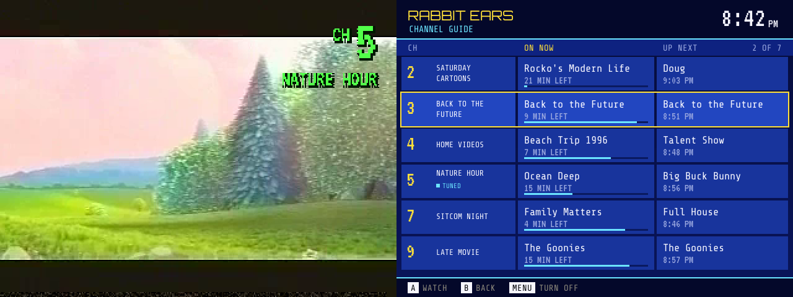

# Rabbit Ears

A 90s TV set for [OnionOS](https://github.com/OnionUI/Onion) on the Miyoo Mini and Mini Plus. Put videos on the SD card and they become channels: flip through them with the d-pad, through a burst of snow, with a green channel number in the corner. Every channel is always "on the air" — tune in and you land mid-show based on the clock, the way TV used to work.

Comes with **vhsify**, a converter that makes any video small, quick to tune in to, and look like it was taped off cable in 1994.



> Built by Claude, Anthropic's AI model, for [snyderman3000](https://github.com/snyderman3000).

## Install

1. Download `RabbitEars-vX.Y.Z-OnionOS.zip` from Releases.
2. Copy its `App` and `Media` folders to the root of your SD card (merge with what's there).
3. Put channels in `Media/TV` (below) and open **Rabbit Ears** from Apps.

It plays through the FFplay that ships with Onion, so there's nothing else to install.

## Channels

| In `Media/TV` | Becomes |
|---|---|
| `Late Movie.mp4` | a channel that loops that video |
| `Saturday Cartoons/` (any depth) | a channel that airs every video inside in order, then repeats; "Ep 2" sorts before "Ep 10" |
| `07 MTV/` or `12 - Movie.mp4` | the leading number picks the channel; the rest count up from 2 |

## Controls

| Button | |
|---|---|
| Up / Down, L / R, Left / Right | change channel |
| B | previous channel |
| A | display: channel, show, clock, time left |
| Select / Start | channel guide |
| Menu | turn the TV off |

## vhsify

```sh
sudo apt install ffmpeg             # 4.4 or newer
chmod +x vhsify
./vhsify ~/Videos/Simpsons -o /media/$USER/SDCARD/Media/TV          # one channel
./vhsify --mirror ~/Videos/TV -o /media/$USER/SDCARD/Media/TV        # whole lineup
./vhsify --fill --wear 2 "Back to the Future.mkv" -o ~/tv            # crop to 4:3, more worn
```

Output is 320×240 H.264 baseline with a keyframe every second and 32 kHz mono AAC — about 180 MB an hour. The look is baked in (horizontal smear, colour bleed and blur, lifted blacks, VCR edge halos, grain, head-switching noise along the bottom, rolling tracking glitches at `--wear` 1–3), so the Mini only decodes a small file.

### On a Raspberry Pi (drop folder)

`converter/` has a Dockerfile and `docker-compose.example.yml`. Anything that lands in the input folder (and stops growing) is converted into the output folder with its sub-folders kept. Settings are environment variables: `WEAR`, `FIT`, `SIZE`, `CRF`, `PRESET`, `INTERVAL`.

## How it works

| File | |
|---|---|
| `channels.go` | scans `Media/TV`, reads MP4 lengths from the `moov` box, and works out what's on air |
| `player.go` | drives Onion's FFplay (2.4): clears its `pos.cfg` resume table so `-ss` works, overlays the channel number PNG with a timed `enable`, flips for the upside-down panel |
| `screens.go` | snow, CRT power on/off, OSD, the channel guide, colour bars |
| `main.go` | the TV: input, tuning, auto-advance, sleep/wake resync |
| `device.go`, `gfx.go` | framebuffer, input and drawing, shared with Rewind and Mixtape |

```sh
./build.sh                  # tests + dist/RabbitEars-vX.Y.Z-OnionOS.zip + dist/vhsify
go run . -shot guide        # osd | info | guide | bars | nosignal | snow | on | off
go run . -scan ~/tv         # print the lineup a folder would make
```

MIT licensed (see [THIRD_PARTY_NOTICES.md](THIRD_PARTY_NOTICES.md)). Fonts: VT323, Share Tech Mono, Orbitron (SIL OFL 1.1). Video playback by Onion's FFplay (FFmpeg), not bundled.
